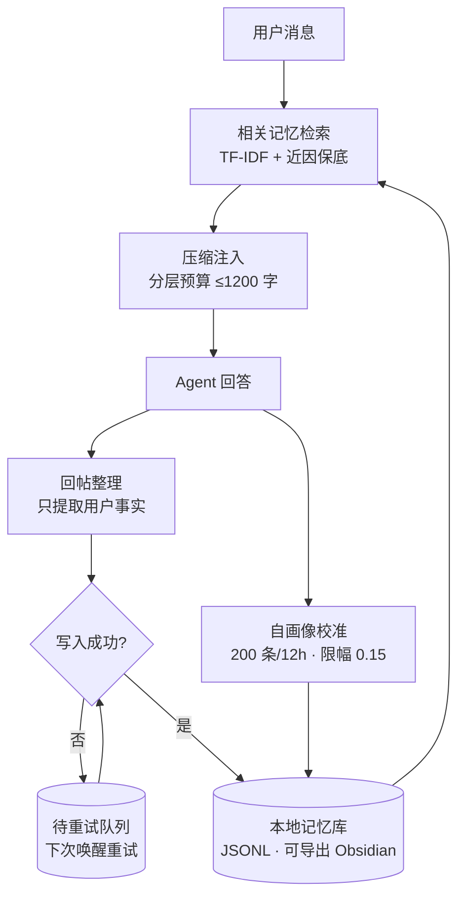

# agent-memory

给 AI Agent 加「长期记忆」的参考实现：让 Agent 在重启、换会话、上下文被截断之后，仍然记得该记住的东西。

零第三方依赖，纯 CPU 可跑，`python memory_engine.py` 一键演示。

---

## 它解决什么问题

上下文窗口是有限的、易失的。Agent 一重启，会话就清零，它什么都不记得。

这个项目把「记忆」从上下文里拆出来，做成独立的持久化层：



**核心思想**：不让模型「全都记着」，只让它在需要时「想起来」。

---

## 核心设计

| 能力 | 做法 |
|---|---|
| **分层压缩** | 越久远的记忆保留越短，总注入预算恒定（默认 1200 字） |
| **按需检索** | TF-IDF 检索 + 近因保底，不把全部记忆塞进上下文 |
| **遗忘机制** | 超过阈值自动淘汰，记忆只增不减是大忌 |
| **离线摘要位** | 摘要留给离线模型（本版用抽取式占位） |

---

## 快速开始

```bash
python memory_engine.py
```

会跑一个完整演示：

```
写入记忆 → 模拟重启（新建实例）→ 恢复 → 按需检索 → 生成注入块 → 遗忘淘汰 → 离线摘要
```

---

## 目录

```
agent-memory/
├── memory_engine.py          # 引擎实现（MemoryEngine 类）
├── docs/
│   └── architecture.md       # 完整架构文档（含成本分析）
├── README.md
└── LICENSE
```

---

## 状态

- [x] 参考实现（可跑、可演示）
- [x] 架构文档
- [ ] 接入真实 Agent 框架（DSH / qq-bridge）
- [ ] 离线摘要接真实 LLM（当前为抽取式占位）

---

## 缘起

最早是为了给一个跑在本机的 QQ 聊天机器人加记忆——让它重启之后还能记得用户。踩过「重启 = 换会话 = 失忆」的坑之后，把这套记忆设计抽成了通用模块。

**记忆系统的质量，一半看「记得准」，一半看「忘得掉」。**
