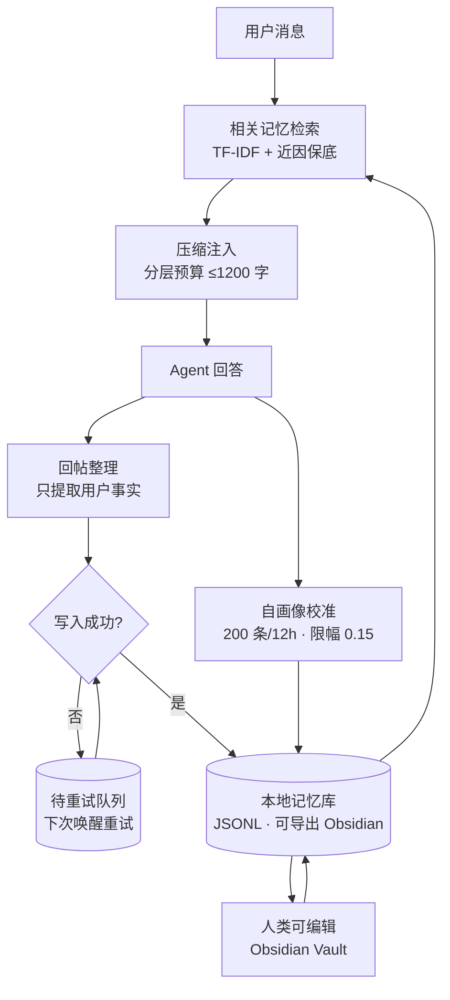

# Agent 长期记忆的工程实现：以 QQ 伴侣「紫苑」为例

> 摘要：这篇文章记录我在一个本地运行的 QQ 聊天机器人上，如何解决「AI 上下文会死」这个核心问题——对话窗口一清空，它就什么都不记得。我实现了一套**多层记忆 + 规则化压缩 + 自我校准**的方案，让 AI 在重启、换会话、上下文被截断之后，依然能「记得」用户、记得进度、记得自己。全文不涉及训练，只涉及工程。

---

## 0. 问题：上下文会死

我用的底座是 DeepSeek Harness（DSH）接 QQ 桥接。一开始就撞上一个致命问题：

> **DSH 客户端一重启，会话 id 就变 not-found，桥接只能新建会话——她的上下文随之清零。**

这不是偶发故障，是**架构性的**。每次重启、每次上下文超长截断，AI 就变成一张白纸。用户前一天晚上跟她说过的话，第二天她全忘了。

这背后是 Agent 领域最经典的问题：**上下文窗口是有限的、易失的，而记忆应该是持久的。**

我的目标不是「让上下文更长」，而是「让记忆不依赖上下文存活」。

---

## 1. 架构总览：四层记忆

我没有做单一的记忆模块，而是按「记忆的生命周期」分成了四层，各自解决不同粒度的遗忘：

```
┌─────────────────────────────────────────────┐
│  第 4 层　自画像（自我校准）   —— 极慢，12 小时一次 │
│  第 3 层　轻量记忆（话题/念头/印象）—— 结构化的即时记忆 │
│  第 2 层　日记          —— 持久化，跨会话唯一活下来的 │
│  第 1 层　模糊记忆（回灌）—— 每轮唤醒注入，按远近压缩  │
└─────────────────────────────────────────────┘
```

核心思想是：**不是所有记忆都值得存全文。** 越久远的记忆，压缩得越狠，占的预算越少。

---

## 2. 第 1 层：模糊记忆——规则化压缩

这是最关键的一层。每次 AI 被唤醒，prompt 里都会注入一段 `【模糊记忆·按远近压缩】`：

| 时间距离 | 保留方式 | 单条预算 |
|---|---|---|
| 近 2 小时 | 逐条，截断到 24 字 | — |
| 今天 | 日记摘要 | 110 字 |
| 近一周 | 每天一条 | 80 字/条 |
| 更早 | 只留索引 | — |

总预算固定 **1200 字符**，按 **45% / 25% / 20% / 10%** 分配给四个时间层。

**关键决策：全部用规则压缩，不调模型。**

为什么不用 LLM 做摘要？三个理由：

1. **成本**：每轮都调模型做摘要，token 消耗会失控；规则压缩零额外成本。
2. **延迟**：唤醒要快，摘要要在几百毫秒内拼好。
3. **可控**：规则是确定性的，我能精确控制每个时间层占多少字，不会出现「模型自由发挥把预算吃光」。

一句话：**记忆压缩这件事，能不用模型就不用模型。** 模型负责「生成」，不负责「记账」。

配套的还有「唤醒快照瘦身」：快照只保留最近 2 条消息、上限 3000 字，历史全部交给模糊记忆。这样上下文窗口里塞的全是「新鲜的」，旧账由模糊记忆这一层兜着。

---

## 3. 第 2 层：日记——唯一跨会话活下来的东西

日记用 JSONL 逐行追加，是最朴素的持久化。

它的意义在于：**当模糊记忆被截断、快照被清空，日记是最后还能从盘里读回来的东西。**

工程上有个小坑值得一提：日记原本塞在工具的数据目录里，后来独立到 `紫苑\日记\`，用一个环境变量 `DIARY_DIR` 覆盖路径。**持久化数据不要和代码/工具目录耦合**，否则迁移和备份都是灾难。

---

## 4. 第 3 层：轻量记忆——结构化槽位

这一层处理「即时但易忘」的东西，用三个结构化槽位：

- `activeTopic`：进行中的话题（聊到哪了）
- `pendingThought`：想说但还没说的话
- `memberImpression`：对某个群友的印象

它的价值在于**结构**：不是一段自由文本，而是带类型、可单独增删查改的条目。这样 AI 可以在「这个话题结束了」的时候，精确地删掉一条 `activeTopic`，而不是从一大段摘要里做文本手术。

---

## 5. 第 4 层：自画像——让 AI 自己改自己

这是最激进的一层，也是我最满意的一层。

**问题**：人设是写在角色卡里的，但角色卡是「静态」的。真实的相处里，AI 应该会根据用户的反馈慢慢调整自己的性格倾向——但不能改角色卡本体（那是身份和安全边界）。

**方案**：

1. 对话流水落盘（`对话流水.jsonl`）
2. 每累积 **200 条他的消息**、且距上次校准 **≥ 12 小时**，桥接在**隐藏会话**里跑一次校准
3. 校准时**只喂用户的原话**，不让 AI 看到自己的输出（避免自我强化）
4. AI 输出一个 JSON，调整 **8 个槽位**：活泼 / 抽象 / 黏人 / 主动 / 撒娇 / 温柔 / 直接 / 吃醋
5. 每次调整限幅 `maxDelta = 0.15`，每轮最多改 3 个槽位
6. 结果写进 `自画像.json` + `变更日志.jsonl`
7. 之后每轮 prompt 注入 `【自我倾向】`（≤ 5 个词）

**三个设计要点：**

- **限幅 + 限量**：防止一次校准把性格调崩。性格要慢变，不能突变。
- **只喂原话**：如果喂「AI 自己的输出」，AI 会照着旧倾向自我复制，形成回音室。
- **永不改角色卡**：角色卡是「我是谁」的锚，自画像是「我最近偏向什么」的微调。前者冻结，后者浮动。

这一层的本质是：**把「记忆」从「事实记忆」升级到「自我认知」。** AI 不但记得你，还记得「我跟你相处时是什么样子」。

---

## 6. 取舍与踩过的坑

| 坑 | 教训 |
|---|---|
| DSH 重启 = 换会话 = 上下文清零 | 记忆必须落盘，不能寄存在 session 里 |
| 用模型做摘要，成本/延迟失控 | 记忆压缩走规则，不走模型 |
| 持久化数据和工具目录耦合 | 数据独立目录 + 环境变量覆盖 |
| 只喂 AI 自己的输出做校准 | 回音室，自我强化——改喂用户原话 |
| 性格校准无上限 | 限幅 0.15、限量 3 条，慢变不突变 |

---

## 7. 还没做的：Honcho

长期方案是想接 **Honcho**（`dsh-honcho` 插件），它提供 `honcho_*` 三个工具，专门做长期记忆的读写。目前是计划，还没落地。

这也印证了上面的判断：**长期记忆这件事，行业里已经有标准解法（Honcho 这类框架），自己从零造是重复劳动，但理解它的原理、并且自己搭过一套，才是真正吃透。**

---

## 8. 可复用的部分

如果把「紫苑」这个具体项目抽象掉，剩下的是一套**通用的 Agent 记忆设计**：

1. **分层**：按时间距离把记忆分层，不同层不同压缩比。
2. **预算制**：给记忆回灌一个总字符预算，按比例分配，防止记忆吃掉整个窗口。
3. **规则化压缩**：能不用模型就不用模型，记账交给规则。
4. **结构化槽位**：可增删改查的条目，优于自由文本。
5. **自我校准带限幅**：让 AI 缓慢地、有边界地更新自我认知，且只从「用户视角」校准。
6. **数据与代码解耦**：持久化数据独立目录。

这六条，任何「想给 Agent 加记忆」的项目都能直接套。

---

## 9. 为什么「塞满」反而更笨：节省上下文的真正理由

很多人以为「省上下文」只是为了省钱、省延迟。那是表面的，真正的理由更深。

**节省上下文有两个动机：**

| 动机 | 逻辑 |
|---|---|
| 省钱 / 提速 | token 越少越便宜越快 |
| **提质量** | 上下文塞太满，模型会**稀释注意力**，抓不住重点 |

第二个才是关键，而且反直觉：**现在上下文窗口已经很大了（百万级），但「塞满」仍然是错的。**

原因叫「大海捞针」（needle in a haystack）：当上下文里塞进十万字的旧聊天，模型回答时反而可能被无关内容带偏，找不到真正相关的信息。**信息不是越多越好，是越「相关」越好。**

由此推出一个反直觉的结论：

> 上下文窗口变大，解决的是「装得下」；解决不了「装得对」。只要模型还靠注意力机制工作，「给它看什么、不看什么」永远比「能看多少」重要。

用认知科学的说法：

```
上下文  = 工作记忆（贵、快、小）
记忆库  = 长期存储（便宜、慢、大）
记忆引擎 = 在这两者之间搬运的调度器
```

人脑不会把一辈子的事都塞进当下的意识，只在需要时「想起来」。这套记忆引擎，就是让 AI 也能「想起来」，而不是「全都记着」。

**所以：在技术突破之前、甚至在突破之后，分层记忆 + 按需检索都有价值。** 它的意义不是「突破模型上限」，而是「让现有模型的能力不被上下文拖后腿」。

---

## 10. 与现有框架的对比

先说结论：Agent 长期记忆不是没人做的领域，恰恰相反，这是 2024-2026 最热的赛道之一。这套系统不是「首创」，而是一次**从零的独立实现**，加上两个市面少见的机制。

### 现有框架一览

| 框架 | 核心做法 | 比我强在哪 |
|---|---|---|
| Mem0 | 提取→存储→向量检索 + 图记忆 | 向量检索、图关系、生态完善 |
| Zep | 时序知识图谱 + 向量 + 记忆蒸馏 | 知识图谱、自动蒸馏 |
| Letta（MemGPT） | 内存分层（核心/归档/召回）+ 自我编辑 | 架构完整、内存可编辑 |
| LangMem | 记忆分类型（语义/程序/情节） | 类型化、标准化 |
| dsh-honcho | DSH 生态的长期记忆插件 | 开箱即用、已集成 DSH |

### 我这套系统独有的两点

**① 自画像人格校准**

8 个性格槽位、限幅 0.15、只喂用户原话。市面框架都是「记事实」，没有「让人格缓慢自我调整」的机制——因为它们的场景是通用 Agent，不是长期相处的伴侣型 Agent。

**② 规则化零成本压缩**

主流框架用 LLM 做摘要/蒸馏，质量高但每次都有模型成本；我用规则压缩，零额外 token，代价是摘要质量不如模型。这是一个明确的取舍：**要质量还是零成本**，我选了后者，因为伴侣场景要高频唤醒、对成本敏感。

### 诚实的定位

- 不是要替代 Mem0 / Letta / Zep——它们在向量检索、知识图谱、蒸馏上做得更完整。
- 这是一次**从零独立实现**的记录，证明理解底层原理，而不是只会调库。
- 加上两个它们没有的机制（自画像 + 零成本压缩），面向「长期相处的人格式 Agent」这个特定场景。

判断一个工程师的水平，不是看「有没有做别人没做过的东西」，而是看「知不知道别人做了什么、自己做的在哪、差在哪、独特在哪」。

---

## 11. 参考架构整合：从一份社区记忆图到 v2 设计

前面十节讲的是「我怎么做出来的」，这一节讲「我看到一份做得更好的设计之后，怎么把它吃进自己的系统」。

### 11.1 参考图

社区流传的一份伴侣型 Agent 记忆架构图（人格叫「大肥鱼」），把记忆拆成五块：聊天链路、本地记忆、回帖整理、失败处理、外部系统。它的完成度比我高，值得逐块对照。

### 11.2 逐模块对照

| 参考图模块 | 它怎么做 | 我的实现 | 差距 |
|---|---|---|---|
| 相关记忆检索 | 检索后取原文片段 | TF-IDF + 近因保底 | ⚠️ 我用词频，它可能用向量 |
| 带入少量上下文 | 记忆 + 自我档案 | 模糊记忆 1200 字预算 | ✅ 相当 |
| 本地记忆库 | 事实/经历/主题索引 | 日记 JSONL + 轻量记忆槽位 | ✅ 相当 |
| **Obsidian 可读可改** | 记忆放 Vault，人可查看编辑 | 无（数据在系统目录） | ❌ 缺 |
| 自我档案 | 她可修改的偏好 | 自画像 8 槽位 + 限幅 + 变更日志 | ✅ 我更强 |
| 只提取用户事实 | 只抽用户侧事实 | 自画像只喂用户原话 | ✅ 一致 |
| 写入组件 | 官方 Basic Memory | 自研 | ⚠️ 可替换 |
| **失败重试** | 同步待处理队列，下次重试 | 只有僵尸清理 | ❌ 缺 |
| 失败记录 | 整理失败记录到 Vault 外 | 无 | ❌ 缺 |

### 11.3 决定吸收的三点

1. **记忆可被人类编辑**：把记忆导出成 Obsidian 可读的 Markdown，用户能翻、能改、能删。伴侣型 Agent 的记忆不该是黑盒。
2. **失败重试队列**：写入失败不丢，落进待重试队列，下次唤醒时重试。
3. **现成组件评估**：Basic Memory / Honcho 这类组件，能省自研成本。

### 11.4 整合后的架构（v2）



比参考图多出来的：自画像校准回路、近因保底、规则化零成本压缩。

### 11.5 一句话

**看到别人做得更好，正确的反应不是自责，是逐模块对照、摘出能抄的、写进自己的下一步。** 这张图的价值不在于它比我好，而在于它免费告诉了我下一版该长什么样。

---

*文档基于本人实际运行的项目整理。人名与联系方式已隐去。*
